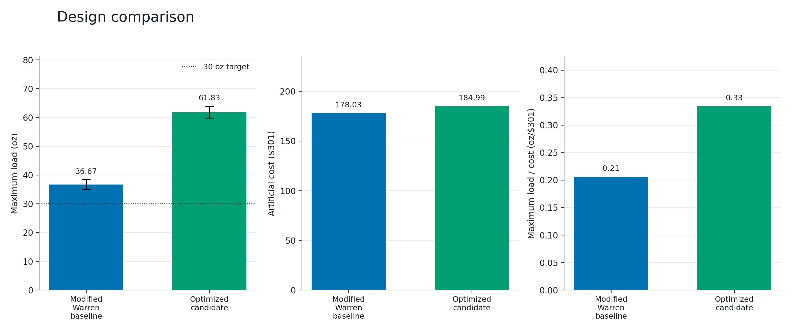
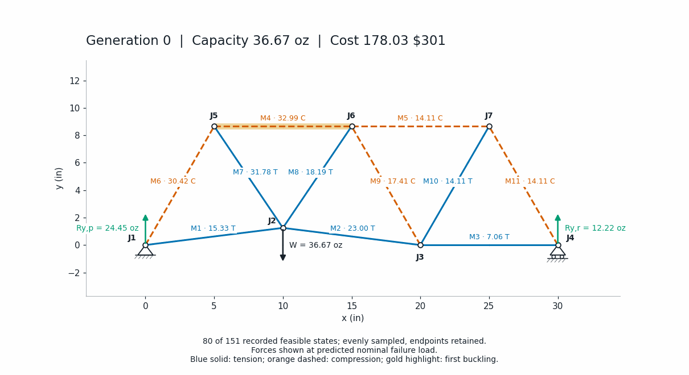

# Optimal Truss

Python tools for the EK301 Fall 2026 preliminary design project: generate planar
trusses, solve member forces, predict first buckling, search geometry, and produce
the tables and figures needed for the report.

The default workflow compares a **modified Warren baseline** with the **best
feasible geometry found by differential evolution**. It uses exact joint
equilibrium and the supplied empirical buckling fit. It does not train a neural
network, prove a global optimum, or simulate a physical 60-second hold test.



The checked example used seeds 42, 43, and 44 for 150 generations each. The best
candidate predicts **61.834 oz**, compared with **36.669 oz** for the baseline;
both pass the modeled specifications. It reached the generation budget rather
than proving convergence. Full-precision example geometry and run metadata are
in `examples/optimized-candidate.json` and `examples/optimized-run.json`.



## Quick start

Python 3.10 or newer:

```bash
python3 -m venv .venv
source .venv/bin/activate
python -m pip install -e '.[test]'
python -m pytest -q
truss demo --out outputs/demo --section A2 --team "Your group names"
```

The default demo runs three independent seeds, with at most 150 generations per
seed. It prints progress every ten generations and writes the baseline,
optimized candidate, comparison, iteration history, and animation. To try the
workflow with a smaller search:

```bash
truss demo --out outputs/quick --generations 20 --population 6 --seeds 42
```

To match the checked example's direct dependency versions, install with
`python -m pip install -e '.[test]' -c requirements-tested.txt` under Python 3.12.

Use `python -m optimal_truss` in place of `truss` when running directly from this
directory. Nothing requires MATLAB, a browser, a GPU, or an external GIF encoder.

## Work on your own designs

```bash
# Generate an editable baseline.
truss generate --kind modified-warren --out outputs/my-design.json

# Edit its node coordinates/member connections, then analyze it.
truss analyze outputs/my-design.json --out outputs/my-analysis --load 30

# Search geometry while preserving those member connections.
truss optimize outputs/my-design.json --out outputs/my-search \
  --generations 300 --population 12 --seeds 42 43 44 --objective load

# Compare saved geometries without repeating the search.
truss compare outputs/my-design.json outputs/my-search/best/geometry.json \
  --out outputs/comparison

# Re-create the animation from the actual saved generations.
truss animate outputs/my-design.json outputs/my-search/history.json \
  --out outputs/replayed-progress
```

`--objective load` maximizes nominal failure load, matching the assignment's
strength goal. `load-cost` maximizes failure load divided by artificial cost.
`lower-load` maximizes the lower envelope obtained from the supplied fit-error
band. The latter is a conservative sensitivity calculation, not a calibrated
probability of survival. Run objectives into separate output directories.

`--kerf 0.04` reserves 0.04 inches per piece in the cutting check. The default
is zero because the brief gives no cutting loss. Joint overlap and hole/end
allowances are not specified and must be addressed before construction.
`--no-figures` exports only numbers and geometry for faster repeated analysis.

## The two baseline choices

The requested straight, equilateral Warren truss is available:

```bash
truss generate --kind equilateral --out outputs/equilateral.json
truss analyze outputs/equilateral.json --out outputs/equilateral
```

It is a **noncompliant reference**, not a submission candidate. Its bottom joints
are at support height; its top joints are much higher than the permitted
0.5–1.5 inches. With the default dimensions, eleven 10-inch members also cannot
be cut from 48/48/24-inch stock, despite totaling only 110 inches.

The modified baseline raises the first interior bottom joint to 1.25 inches.
It retains the horizontal top chord and Warren connections, but the affected
triangles are no longer equilateral. The default 30-inch-span geometry passes
the implemented specifications, including an actual stock-cutting assignment.

`generate` writes geometry without claiming compliance. `analyze` always writes
the detailed checks and returns exit code **2** if any fail. Invalid input or
unstable equilibrium returns **1**. Successful analysis returns **0**.
Optimization requires a feasible starting design and saves only feasible
incumbents (the best design found so far).

## Generated files

Each analysis directory contains:

| File | Use |
|---|---|
| `geometry.json` | Full-precision coordinates and member connections |
| `summary.json` | Capacity, uncertainty, cost, checks, fit, and software versions |
| `analysis.md` | Readable results, member table, and figure-caption guidance |
| `members.csv`, `members.tex` | Member table for a document or LaTeX report |
| `joints.csv`, `reactions.csv` | Geometry and support reactions |
| `cut_plan.csv` | Assignment of members to stock bars, when feasible |
| `design.mat` | Course-format `C`, `Sx`, `Sy`, `X`, `Y`, `L` arrays |
| `figures/` | PNG, SVG, and PDF versions of every static figure |

Figures include labeled geometry and lengths, axial forces at the selected load,
forces at nominal failure, a whole-truss free-body diagram, a loaded-joint
free-body diagram, compression demand versus buckling capacity, the empirical
fit, and member-force response to increasing load. Comparison figures show
capacity, cost, and load/cost separately. SVG/PDF retain vector lines and text;
PNG is convenient for Google Docs.

Search directories additionally contain per-seed geometry, metadata, and complete
`history.json` traces; `runs.csv` compares seeds. `best/` contains the winning
analysis, and `progress/` contains the trace plot and GIF. The GIF samples real
saved generations, with the frame limit documented in its caption; it does not
invent intermediate geometry. Keep the full trace for reproducibility.

All generated output is ignored by Git. Course PDFs and private report files are
not distributed with this repository. Use different `--out` directories when
you want to retain earlier results.

## Input format and Python API

Coordinates are **inches**; forces are **ounce-force**, not mass. JSON and Python
member endpoints are **zero-based**; report labels `J1`, `M1`, etc. are one-based.
For example, member `[0, 2]` connects `J1` to `J3`.

```python
from optimal_truss.geometry import warren
from optimal_truss.analysis import solve
from optimal_truss.constraints import validate
from optimal_truss.optimize import optimize_geometry
from optimal_truss.plotting import report_figures, plot_joint

baseline = warren(raised_load=True)
analysis = solve(baseline, load_oz=30)
assert all(check.passed for check in validate(baseline, analysis))
print(analysis.failure_load, analysis.critical_members)
optimized = optimize_geometry(baseline, generations=150, seed=42)
report_figures(optimized.analysis, "outputs/python/figures")
plot_joint(analysis, joint=baseline.load_joint, output_dir="outputs/python/joint")
```

Use `Truss.from_dict(...)` or `read_truss(path)` for custom geometry. Construct
`BucklingLaw(...)` and `Constraints(...)` explicitly in the Python API if course
data or limits change. Search metadata records these choices. The CLI uses the
Fall 2026 defaults.

## Verification and report use

The tests check analytical force solutions, force/moment equilibrium, linear
load scaling, buckling and uncertainty, mechanisms, geometric violations, stock
packing, MATLAB round-trip interpretation, reproducible search, and exported
figures. These checks verify the implementation; **you still need to solve the
course's assigned practice truss by hand and compare it with your code**.
Run `python examples/verify_equilibrium.py` for a small, independent analytical
example that also exercises horizontal loading.

See [the mechanics and optimization method](docs/method.md),
[the report checklist](docs/report-checklist.md), and
[source provenance](docs/sources.md). Example inputs live in `examples/`.

## Scope of the optimized result

The search moves all unsupported joints and varies support span within the
limits. Connectivity, number of joints, and designated load/support joints stay
fixed. It does not compare every possible truss topology. Separate seeds help
expose sensitivity to search initialization; they do not prove optimality.

The model neglects member self-weight, bending, connection flexibility, tensile
rupture, joint failure, out-of-plane instability, fabrication tolerances, and
time-dependent behavior. Report the result as a **predicted first-buckling load
under the stated assumptions**. Confirm the course interpretation and physical
construction details before building.
